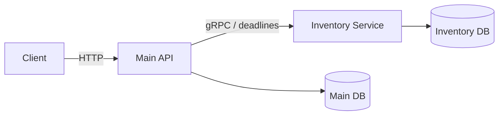

# Inventory Microservice

NestJS + CommonJS + PostgreSQL/TypeORM + gRPC. This service exclusively owns stock quantities and inventory reservations.
The Main API in `../e-commerce` owns users, products, prices, and orders, and reads or reserves inventory through gRPC.



## Local setup

You need Node.js 24 and PostgreSQL. Use a separate database and database account for each application.
The `.env.example` file documents the settings. Fill in your local environment files and keep secrets out of Git.
Real `.env` files were not modified during this implementation.

From the Inventory directory, using PowerShell:

```powershell
npm.cmd ci
npm.cmd run build
npm.cmd run migration:run
npm.cmd run start:dev
```

In another terminal, inside `../e-commerce`:

```powershell
npm.cmd ci
npm.cmd run build
npm.cmd run migration:run
npm.cmd run start:dev
```

On Linux, use `npm` instead of `npm.cmd`. The Main API reads its gRPC settings from its own environment file:

```dotenv
INVENTORY_GRPC_URL=127.0.0.1:50051
INVENTORY_PROTO_PATH=proto/inventory.proto
INVENTORY_READ_TIMEOUT_MS=1000
INVENTORY_RESERVE_TIMEOUT_MS=3000
INVENTORY_RELEASE_TIMEOUT_MS=3000
INVENTORY_OPERATION_TIMEOUT_MS=60000
INVENTORY_COMPENSATION_INTERVAL_MS=5000
INVENTORY_COMPENSATION_RETRY_MS=5000
```

Do not use `synchronize: true`. If an existing database was created with schema synchronization, reconcile its schema and migration history before running the initial migration. Do not blindly run table-creation migrations against existing tables.

Creating a product does not automatically create its stock record: quantities belong to Inventory. After creating products in Main, provision their initial stock records from Inventory:

```powershell
npm.cmd run seed:stock -- 1:20 2:10
```

This command inserts missing records only. It preserves existing quantities and does not run automatically at startup.

## Contract and ownership

`proto/inventory.proto` is the authoritative contract. Main has an identical copy at `../e-commerce/proto/inventory.proto`.
The existing `package inventory.v1`, RPC names, and field numbers remain unchanged.

| RPC            | Behavior                                                                                   |
| -------------- | ------------------------------------------------------------------------------------------ |
| `GetStock`     | Returns one product's available quantity, or `NOT_FOUND`                                   |
| `GetStocks`    | Backward-compatible batch query for product pages; unknown products are omitted            |
| `ReserveStock` | Reserves every requested item, or rolls back the entire reservation                        |
| `ReleaseStock` | Restores a reservation once, or durably cancels an ID before a delayed reservation arrives |

TypeScript field names use camelCase through `keepCase: false`. Product IDs use strings through `longs: String`.
Do not convert Inventory IDs to JavaScript numbers. The maximum supported ID is `9223372036854775807`.
IDs are normalized to canonical decimal strings, and duplicate products are rejected after normalization.
A request accepts up to 100 products, with positive integer quantities within the `int32` range.

Error codes are `INVALID_ARGUMENT` for invalid input, `NOT_FOUND` for missing records, `FAILED_PRECONDITION` for insufficient stock or a terminal reservation, `ALREADY_EXISTS` for reusing an active reservation ID with different items, `ABORTED` for transaction conflicts or lock timeouts that can be retried with the same identity, and `UNAVAILABLE` when the Inventory database is unavailable.
Unexpected errors become `INTERNAL` without exposing SQL details to clients.

## Reservation states and concurrency

| Current state | ReserveStock                                                     | ReleaseStock                                       |
| ------------- | ---------------------------------------------------------------- | -------------------------------------------------- |
| No record     | Creates `RESERVED` and deducts every quantity in one transaction | Creates `CANCELLED` without items or stock changes |
| `RESERVED`    | Same items: returns the stored result; different items: conflict | Restores quantities and transitions to `RELEASED`  |
| `RELEASED`    | Rejects reuse                                                    | Succeeds without restoring quantities again        |
| `CANCELLED`   | Rejects the delayed reservation                                  | Succeeds without changes                           |

Both Reserve and Release begin with `INSERT ... ON CONFLICT DO NOTHING` on the same unique key, followed by `SELECT ... FOR UPDATE` on the reservation row.
A row lock alone cannot protect a record that does not exist, so insertion and database uniqueness are essential parts of the protocol.

When cancellation arrives first:

1. Release records `CANCELLED` and commits.
2. The delayed reservation attempts to insert the same `reservation_id`.
3. The unique constraint prevents a new record from being created.
4. Reserve reads `CANCELLED` under the row lock and rejects the request before deducting stock.

When reservation starts first, Release waits for its insertion or row lock until commit or rollback. After a successful reservation, Release restores the quantities once; after a failed reservation, Release creates a tombstone.
Concurrent releases wait on the same record and then observe its terminal state.

Stock is deducted using `UPDATE ... WHERE available_quantity >= requested`, the primary protection against overselling.
Every item belongs to one transaction, and products are processed in a consistent numeric order to reduce deadlocks. Other deadlocks remain possible and are mapped to `ABORTED`.
With PostgreSQL, `manager.query(UPDATE...)` returns `[rows, affectedCount]`; the implementation checks the affected count rather than the length of this outer array.

Database constraints enforce nonnegative stock, positive item quantities, unique reservation IDs, unique reservation/product pairs, and foreign keys within the Inventory database.
Do not delete tombstones or idempotency records while delayed requests could still arrive. A deliberate retention policy is part of the protection against ID reuse.

## Orders and compensation across two databases

Clients send a stable `Idempotency-Key` when retrying the same logical HTTP request:

```http
POST /orders
Authorization: Bearer <token>
Idempotency-Key: checkout-example-001
Content-Type: application/json

{"items":[{"productId":1,"quantity":2},{"productId":2,"quantity":1}]}
```

The same user, key, and items return the same completed order. Different items return HTTP 409.
An operation still processing or awaiting compensation returns 409; clients can check again by repeating POST with the same key.
A cancelled operation cannot create a new order with that key. The header remains optional for compatibility with existing clients, but **independent HTTP requests without it are not protected against duplicate orders**.

The workflow is:

1. Validate products and availability and capture price snapshots before the network call, without holding a database transaction open across gRPC.
2. Persist `inventory_order_operations` in Main DB before calling gRPC, including a stable reservation UUID and the item/price snapshots.
3. Call ReserveStock once for the entire basket with an explicit deadline.
4. Save Order and OrderItems and mark the operation `COMPLETED` in one local transaction. The operation-row lock prevents recovery from cancelling an operation whose commit succeeded.
5. If reservation fails, its outcome is unknown, or order persistence fails, change the still-`PENDING` operation to `CANCEL_PENDING` and attempt Release with the same identity.
6. If Release fails, retain the durable operation and let the background worker retry with the same reservation ID. Mark it `CANCELLED` only after gRPC succeeds.

The worker also recovers expired `PENDING` operations after a crash. It uses `FOR UPDATE SKIP LOCKED` and persisted retry timestamps, and can safely run in multiple instances.
Operation-row locking coordinates two outcomes: either Order and `COMPLETED` commit together, or cancellation wins and fences a stale order writer.
If the COMMIT response is lost, the order may already exist; compensation never blindly changes a `COMPLETED` operation.

Cancelling an Order writes its `CANCELLED` status and compensation request in the same Main transaction. Deleting an unshipped Order also requests Release; deleting shipped or delivered sales history does not return sold goods to stock.
A cancelled Order does not imply that stock has already been restored over the network: compensation may still be pending.

The databases do not share a distributed transaction. Recovery is eventual and requires the Main worker, Inventory, and their databases to become available again. Permanent outages or data loss require operator intervention. Do not manually delete operations with unresolved reservations or compensation.
Legacy Main orders retain `inventory_reservation_id = NULL`; no reservations are invented for historical orders.

To monitor compensation in Main DB:

```sql
SELECT id, status, attempts, last_error_code, next_attempt_at
FROM inventory_order_operations
WHERE status IN ('PENDING', 'CANCEL_PENDING')
ORDER BY created_at;
```

## Tests

```powershell
npm.cmd run build
npm.cmd run lint
npm.cmd test
npm.cmd run test:db
```

`test:db` starts a disposable PostgreSQL cluster using the installed `initdb` and `pg_ctl` binaries, builds both applications, tests HTTP → gRPC → two independent databases, and stops the server in `finally`.
It does not read `.env` to provision test databases or run migrations against application databases.
On Windows, set `PG_BIN` if PostgreSQL is installed outside the default location. Temporary PostgreSQL files remain in the system temporary directory for diagnostics.
On Linux, initdb cannot run as root; use a regular user or provide dedicated test database URLs as described below.

You can supply `TEST_DATABASE_URL` for a dedicated database named `inventory_test` or `inventory_test_<suffix>`, and `TEST_MAIN_DATABASE_URL` for one named `ecommerce_test` or `ecommerce_test_<suffix>`.
The harness rejects application database names, isolates Inventory in its own schema, and resets the **dedicated Main test database** between tests. Never supply a shared or application database, even if you rename it.

```powershell
# Inventory only, when the Main API is unavailable
npm.cmd run test:db -- --inventory-only

# Main API at a different path
npm.cmd run test:db -- --main-api ../e-commerce

# Existing Main HTTP tests
Set-Location ../e-commerce
npm.cmd test -- --runInBand
npm.cmd run test:e2e -- --runInBand
```

If Windows Application Control blocks Main's native oxlint binary, run the permitted Inventory installation from Main's directory, using Main's own configuration:

```powershell
node ../inventory-service/node_modules/oxlint/bin/oxlint --type-aware src/ test/
```

This fallback was used successfully during verification without disabling Windows policy.

Tests cover actual constraints, multi-product rollback, competition for the final unit, concurrent requests with the same identity, simultaneous releases, both Reserve/Release orderings, and a deadline after a real commit.
System tests reject order INSERTs using an actual PostgreSQL trigger and verify failed compensation and recovery by a fresh worker, crashes before order persistence, HTTP idempotency, order permissions, and product quantities.
The system-test harness substitutes JWT identity while retaining the real RolesGuard. It is not a complete JWT login test.

## Docker Compose

Fill in the Compose environment variables in your local file and keep Main in the adjacent directory:

```powershell
docker compose -f compose.yaml up --build -d
docker compose -f compose.yaml logs -f api inventory
```

Startup order is: healthy PostgreSQL → migrations for each database → healthy Inventory → Main API.
The applications use separate accounts and databases on the same PostgreSQL server.
Main reaches Inventory at `inventory:50051`. Neither the gRPC port nor the database port is published to the host; HTTP is bound to `127.0.0.1:3000` for a reverse proxy.
Account/database initialization runs only when a new volume is created. With an existing volume, provision the accounts and databases administratively; do not delete the volume to fix configuration.

```powershell
# After creating catalogue products 1 and 2, provision their stock records:
docker compose -f compose.yaml exec inventory node scripts/seed-stock.cjs 1:20 2:10
```

Nothing was deployed to Azure. See the [implementation and reference review](docs/implementation-review.md) for design decisions and remaining limitations.
