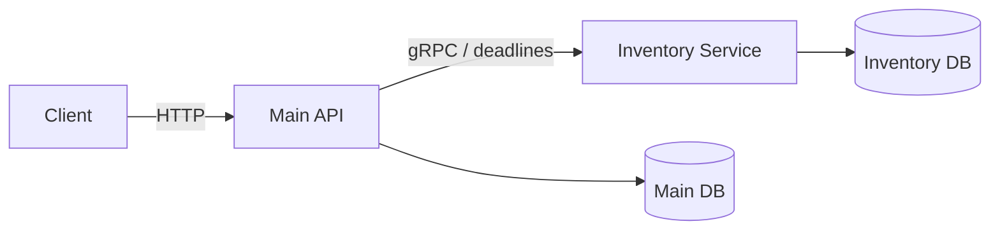

# Inventory Microservice

NestJS + CommonJS + PostgreSQL/TypeORM + gRPC. المخزون والحجوزات ملك هذه الخدمة حصراً.
الـ Main API الموجود في `../e-commerce` يملك المستخدمين والمنتجات والأسعار والطلبات، ويقرأ/يحجز المخزون عبر gRPC.



## التشغيل محلياً

تحتاج Node.js 24 وPostgreSQL. استخدم قاعدة مستقلة وحساباً مستقلاً لكل تطبيق.
ملف `.env.example` يشرح المتغيرات؛ املأ ملفك المحلي ولا تضع أسرارك في Git.
لم يتم تعديل ملفات `.env` الحقيقية أثناء تنفيذ هذا العمل.

من مجلد Inventory، على PowerShell:

```powershell
npm.cmd ci
npm.cmd run build
npm.cmd run migration:run
npm.cmd run start:dev
```

ومن ترمينال آخر داخل `../e-commerce`:

```powershell
npm.cmd ci
npm.cmd run build
npm.cmd run migration:run
npm.cmd run start:dev
```

على Linux استخدم `npm` مكان `npm.cmd`. الـ Main API يقرأ إعدادات gRPC من ملفه الخاص:

```dotenv
INVENTORY_GRPC_URL=127.0.0.1:50051
INVENTORY_PROTO_PATH=proto/inventory.proto
INVENTORY_READ_TIMEOUT_MS=1000
INVENTORY_RESERVE_TIMEOUT_MS=3000
INVENTORY_RELEASE_TIMEOUT_MS=3000
INVENTORY_OPERATION_TIMEOUT_MS=60000
INVENTORY_COMPENSATION_INTERVAL_MS=5000
INVENTORY_COMPENSATION_RETRY_MS=5000
```

لا تستخدم `synchronize: true`. قواعد موجودة أُنشئت سابقاً بواسطة synchronize تحتاج مطابقة schema ومراجعة سجل migrations قبل تشغيل initial migration؛ لا تشغّل إنشاء الجداول فوق جداول موجودة عشوائياً.

إنشاء منتج لا ينشئ كمية تلقائياً: إدارة الكميات تابعة لـ Inventory. بعد إنشاء منتجات في Main، يمكن تجهيز سجلاتها الأولية من Inventory:

```powershell
npm.cmd run seed:stock -- 1:20 2:10
```

هذا الأمر يضيف السجلات الناقصة فقط، ولا يغيّر كمية موجودة ولا يعمل تلقائياً عند الإقلاع.

## العقد والملكية

`proto/inventory.proto` هو العقد الأساسي. نسخة Main في `../e-commerce/proto/inventory.proto` مطابقة له.
بقيت `package inventory.v1` وأسماء RPCs وأرقام الحقول القديمة ثابتة.

| RPC            | السلوك                                                                         |
| -------------- | ------------------------------------------------------------------------------ |
| `GetStock`     | كمية منتج واحد، أو `NOT_FOUND`                                                 |
| `GetStocks`    | إضافة متوافقة لقراءة صفحة منتجات بطلب واحد؛ المنتجات المجهولة تُحذف من القائمة |
| `ReserveStock` | حجز جميع العناصر أو rollback لجميعها                                           |
| `ReleaseStock` | إرجاع الحجز مرة واحدة، أو تسجيل إلغاء دائم لحجز لم يصل بعد                     |

الأسماء داخل TypeScript هي camelCase بفضل `keepCase: false`، ومعرّفات `int64` دائماً strings بفضل `longs: String`.
لا تحول معرّف Inventory إلى JavaScript number. الحد الأعلى هو `9223372036854775807`.
تُطبَّع الأرقام إلى الصيغة العشرية القياسية، وتُرفض المنتجات المكررة بعد التطبيع.
الطلب الواحد يقبل حتى 100 منتج، والكمية عدد صحيح موجب ضمن `int32`.

أكواد الأخطاء: `INVALID_ARGUMENT` للمدخلات، `NOT_FOUND` للسجل المفقود، `FAILED_PRECONDITION` لنقص الكمية/الحجز المنتهي، `ALREADY_EXISTS` لإعادة استخدام حجز فعال بمحتوى مختلف، `ABORTED` لتعارض معاملات/مهلة قفل قابلة لإعادة المحاولة بنفس الهوية، و`UNAVAILABLE` لتعطل قاعدة المخزون.
الأخطاء غير المتوقعة تصبح `INTERNAL` دون تفاصيل SQL للعميل.

## حالات الحجز ومنع السباقات

| الحالة الحالية | ReserveStock                                            | ReleaseStock                                |
| -------------- | ------------------------------------------------------- | ------------------------------------------- |
| لا يوجد سجل    | إنشاء `RESERVED` مع خصم كل الكميات في transaction واحدة | إنشاء `CANCELLED` بدون عناصر أو تعديل كميات |
| `RESERVED`     | نفس المحتوى: إعادة النتيجة؛ محتوى مختلف: conflict       | إرجاع الكميات ثم التحول إلى `RELEASED`      |
| `RELEASED`     | رفض إعادة الاستخدام                                     | نجاح بدون زيادة إضافية                      |
| `CANCELLED`    | رفض الحجز المتأخر                                       | نجاح بدون تغيير                             |

كل من Reserve وRelease يبدأ بـ `INSERT ... ON CONFLICT DO NOTHING` على نفس المفتاح الفريد، ثم `SELECT ... FOR UPDATE` لنفس سجل الحجز.
قفل سجل غير موجود وحده لا يكفي، لذلك الإدخال وقيد uniqueness جزء أساسي من البروتوكول.

إذا وصل الإلغاء أولاً:

1. يسجل `CANCELLED` ويعمل commit.
2. يصل الحجز المتأخر ويحاول إدخال نفس `reservation_id`.
3. القيد الفريد يمنع إنشاء سجل جديد.
4. الحجز يقرأ `CANCELLED` تحت القفل ويرفض قبل خصم أي كمية.

إذا بدأ الحجز أولاً، فالإلغاء ينتظر إدخاله/قفل سجله حتى commit أو rollback. بعد نجاح الحجز يعيد الإلغاء الكميات مرة واحدة؛ وبعد فشل الحجز ينشئ الإلغاء tombstone.
الإلغاء المتزامن ينتظر نفس السجل ثم يرى الحالة النهائية.

الكميات تُعدَّل بواسطة `UPDATE ... WHERE available_quantity >= requested`، وهو الحاجز الأساسي ضد overselling.
كل عناصر الحجز ضمن transaction واحدة، وبترتيب رقمي ثابت للمنتجات لتقليل deadlocks. قد تبقى deadlocks أخرى، ولذلك تتم ترجمتها إلى `ABORTED`؛ لا يوجد ادعاء بإزالتها بالكامل.
في PostgreSQL تعيد `manager.query(UPDATE...)` القيمة `[rows, affectedCount]`؛ يتم فحص عدد الصفوف لا طول هذه المصفوفة.

قيود قاعدة البيانات تحمي عدم سلبية الكمية، إيجابية كمية العنصر، uniqueness للحجز ولزوج الحجز/المنتج، وFKs داخل قاعدة Inventory.
لا تحذف tombstones أو سجلات منع التكرار أثناء احتمال وصول رسائل قديمة؛ سياسة الاحتفاظ جزء من ضمان منع إعادة الاستخدام.

## الطلبات والتعويض بين قاعدتين

يرسل العميل `Idempotency-Key` ثابتاً عند إعادة محاولة نفس طلب HTTP:

```http
POST /orders
Authorization: Bearer <token>
Idempotency-Key: checkout-example-001
Content-Type: application/json

{"items":[{"productId":1,"quantity":2},{"productId":2,"quantity":1}]}
```

نفس المستخدم ونفس المفتاح ونفس العناصر يرجعون نفس الطلب المكتمل. اختلاف العناصر يرجع 409.
طلب قيد التنفيذ أو التعويض يرجع 409، ويمكن إعادة الاستعلام بنفس المفتاح بإعادة POST.
عملية ملغاة لا تنشئ طلباً جديداً بنفس المفتاح. المفتاح اختياري للحفاظ على توافق العملاء القدامى، لكن **لا يوجد ضمان منع تكرار طلبات HTTP مستقلة بدونه**.

التنفيذ:

1. التحقق من المنتجات وإتاحتها وأخذ نسخ الأسعار خارج أي اتصال شبكي داخل transaction.
2. حفظ `inventory_order_operations` في Main DB قبل إرسال gRPC، بهوية حجز UUID ثابتة ونسخة العناصر والأسعار.
3. استدعاء ReserveStock مرة واحدة لكل السلة، مع deadline صريح.
4. حفظ Order وOrderItems وتحويل العملية إلى `COMPLETED` في transaction محلية واحدة. قفل العملية يمنع recovery من إلغاء عملية نجح commit الخاص بها.
5. عند فشل الحجز أو غموض نتيجته أو فشل حفظ الطلب، تحويل العملية الباقية `PENDING` إلى `CANCEL_PENDING` ومحاولة Release بنفس الهوية.
6. عند فشل Release يبقى السجل دائماً وتعيد background worker المحاولة بهوية الحجز نفسها. لا تُسجَّل `CANCELLED` إلا بعد نجاح gRPC.

العامل يسترد أيضاً عمليات `PENDING` التي انتهت مهلتها بعد crash. يستخدم `FOR UPDATE SKIP LOCKED` ومواعيد المحاولة في قاعدة البيانات، ويعمل بأمان مع أكثر من instance.
قفل العملية يفصل بين مسارين: إما Order + `COMPLETED` ينجحان، أو الإلغاء يفوز ويمنع كاتب طلب قديم من إنشاء Order لاحقاً.
إذا ضاع جواب COMMIT فقد يكون الطلب محفوظاً فعلياً؛ التعويض لا يغيّر عملية `COMPLETED`.

إلغاء Order يكتب حالة `CANCELLED` وطلب التعويض في transaction Main نفسها. حذف Order غير مشحون يطلب Release أيضاً؛ حذف سجل بيع مشحون/مسلّم لا يعيد بضائع مباعة إلى المخزون.
حالة Order الملغاة لا تعني أن الشبكة أعادت الكمية فوراً؛ يمكن أن يكون التعويض قيد الانتظار.

القاعدتان لا تشتركان بمعاملة موزعة. الاسترداد هنا eventual ويتطلب عودة Main worker وInventory وقواعدهما للعمل. تعطل دائم أو فقد بيانات يحتاج تدخل المشغل. لا تُحذف سجلات العمليات يدوياً أثناء وجود حجز/تعويض معلق.
سجلات Main القديمة لها `inventory_reservation_id = NULL` وتبقى متوافقة؛ لا ننسب لها حجوزات لم تحصل فعلياً.

لمراقبة التعويض داخل Main DB:

```sql
SELECT id, status, attempts, last_error_code, next_attempt_at
FROM inventory_order_operations
WHERE status IN ('PENDING', 'CANCEL_PENDING')
ORDER BY created_at;
```

## الاختبارات

```powershell
npm.cmd run build
npm.cmd run lint
npm.cmd test
npm.cmd run test:db
```

`test:db` ينشئ PostgreSQL مؤقتاً باستخدام `initdb` و`pg_ctl` المثبتين، ويبني التطبيقين ويختبر HTTP → gRPC → قاعدتين مستقلتين، ثم يوقف الخادم في `finally`.
لا يقرأ `.env` لإنشاء قواعد الاختبار ولا يشغّل migrations على قواعد التطبيق.
على Windows يمكن ضبط `PG_BIN` إذا لم يكن PostgreSQL بمسار التثبيت المعتاد. ملفات PostgreSQL المؤقتة تبقى في مجلد النظام المؤقت للتشخيص.
على Linux لا يمكن تشغيل initdb كمستخدم root؛ استخدم مستخدماً عادياً أو قواعد الاختبار الصريحة التالية.

يمكن توفير `TEST_DATABASE_URL` لقاعدة مخصصة يبدأ اسمها بـ `inventory_test`، و`TEST_MAIN_DATABASE_URL` لقاعدة مخصصة يبدأ اسمها بـ `ecommerce_test`.
يمنع harness أسماء قواعد التطبيق، ويعزل Inventory في schema خاص، ويعيد تجهيز **قاعدة Main الاختبارية** بين الاختبارات. لا تمرر قاعدة مشتركة أو قاعدة التطبيق حتى لو أعدت تسميتها.

```powershell
# Inventory فقط، إذا لم يكن Main API موجوداً
npm.cmd run test:db -- --inventory-only

# Main بمسار مختلف
npm.cmd run test:db -- --main-api ../e-commerce

# اختبارات Main HTTP الحالية
Set-Location ../e-commerce
npm.cmd test -- --runInBand
npm.cmd run test:e2e -- --runInBand
```

إذا منعت Windows Application Control ملف oxlint الأصلي في Main، يمكن فحصه من مجلد Main بواسطة النسخة المثبتة والمسموح تشغيلها في Inventory، بنفس إعدادات Main:

```powershell
node ../inventory-service/node_modules/oxlint/bin/oxlint --type-aware src/ test/
```

هذا البديل استُخدم بنجاح في الفحص؛ لم يتم تعطيل سياسة Windows.

الاختبارات تغطي القيود الفعلية، rollback متعدد المنتجات، المنافسة على آخر قطعة، طلبات متعددة بنفس الهوية، الإلغاء المتزامن، كلا ترتيبي Reserve/Release، وdeadline بعد commit حقيقي.
اختبارات النظام تفشل INSERT الطلب فعلياً بواسطة PostgreSQL trigger، وتختبر تعويضاً فاشلاً واسترداده بعامل جديد، crash قبل حفظ الطلب، HTTP idempotency، صلاحيات الطلبات، وكميات المنتجات.
هوية المستخدم في اختبار النظام تُحقن ببديل JWT؛ يبقى RolesGuard الحقيقي فعالاً. هذا الاختبار ليس اختبار تسجيل دخول JWT كاملاً.

## Docker Compose

بعد تعبئة متغيرات Compose في ملفك المحلي وتثبيت Main في المسار المجاور:

```powershell
docker compose -f compose.yaml up --build -d
docker compose -f compose.yaml logs -f api inventory
```

الترتيب هو: PostgreSQL صحي → migrations لكل قاعدة → Inventory صحي → Main API.
الخدمتان تستخدمان مستخدمين وقاعدتين مستقلتين على نفس PostgreSQL server.
عنوان Main الداخلي للمخزون هو `inventory:50051`. منفذ gRPC وقاعدة البيانات غير منشورين على المضيف؛ HTTP منشور على `127.0.0.1:3000` لربطه بـ reverse proxy.
تهيئة المستخدمين/القواعد تعمل عند إنشاء volume جديد فقط. مع volume موجود جهّز الحسابات والقواعد إدارياً؛ لا تحذف volume لإصلاح الإعداد.

```powershell
# بعد إنشاء منتجي الكتالوج 1 و2، تجهيز مخزونهما فقط:
docker compose -f compose.yaml exec inventory node scripts/seed-stock.cjs 1:20 2:10
```

لم يتم نشر أي شيء على Azure. راجع [ملاحظات التنفيذ والمرجع](docs/implementation-review.md) لمعرفة القرارات والحدود.
